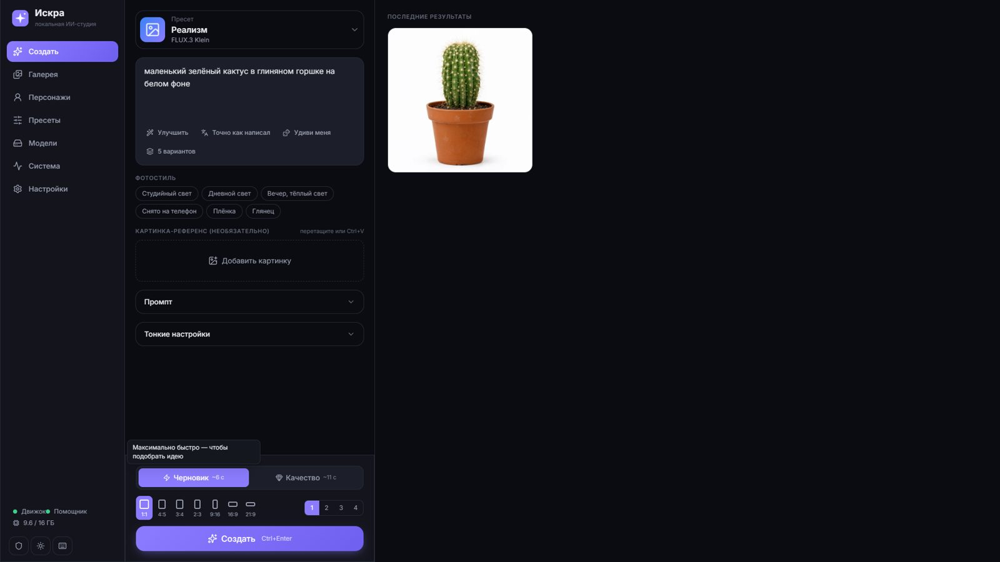
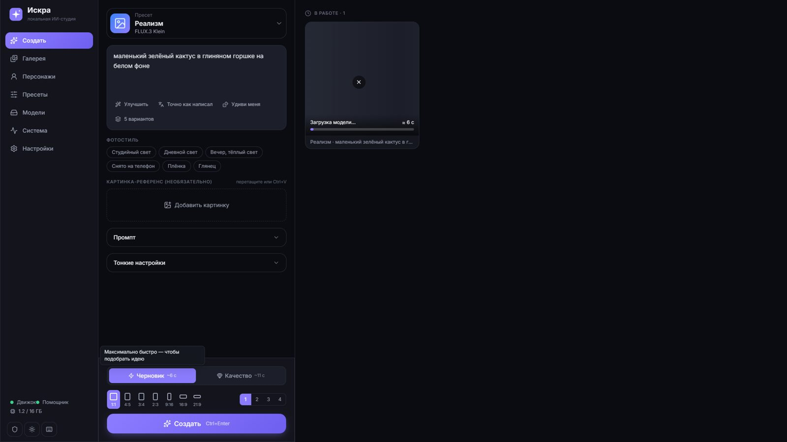
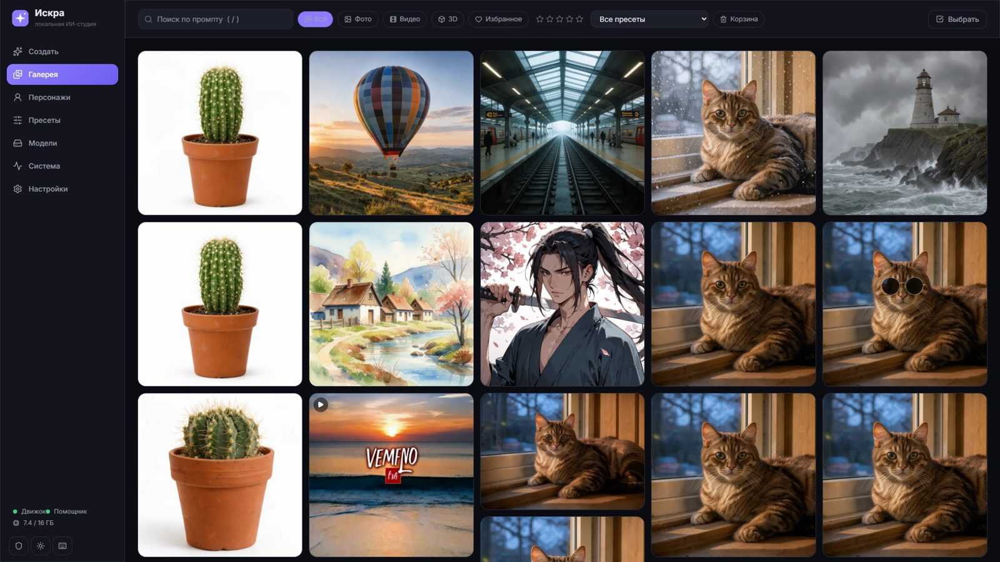
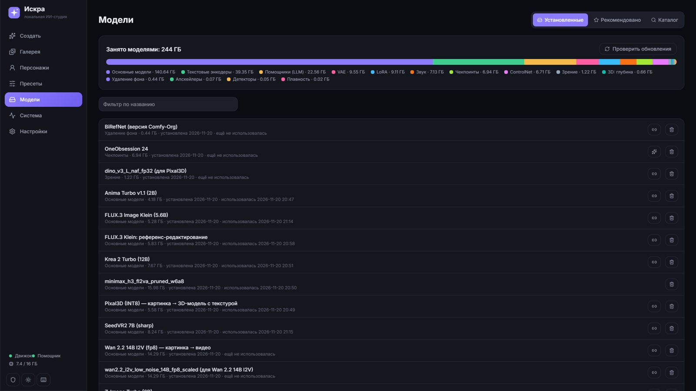
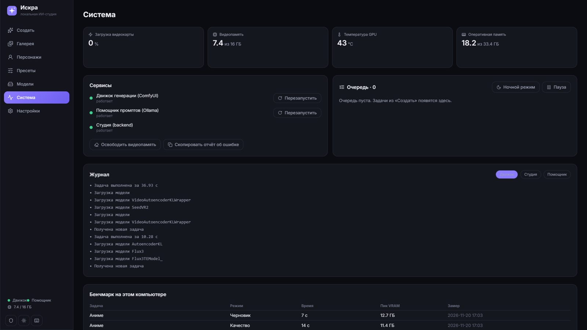
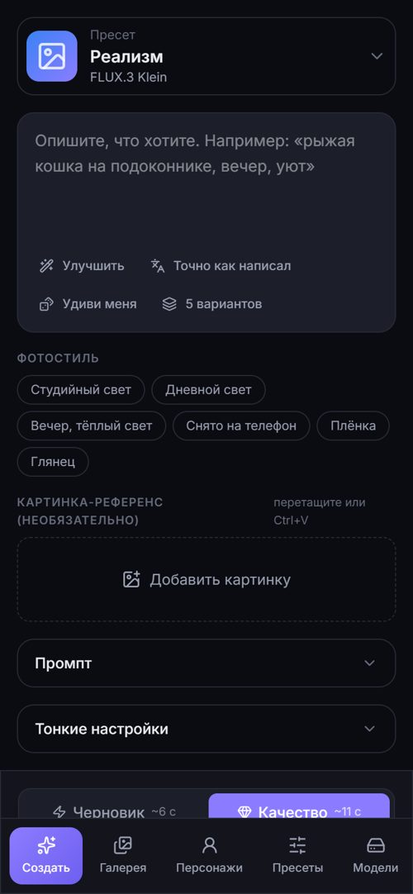

# Искра — локальная ИИ-студия

Фото, арт, видео со звуком и 3D-модели на вашем компьютере. Без подписок и лимитов: картинки никуда не отправляются.



---

## Как запустить

- Двойной щелчок по ярлыку **«Искра»** на рабочем столе или в меню «Пуск». Если ярлыков нет, запустите `F:\AI-Studio\Искра.bat`.
- Откроется окно студии. Движок генерации (ComfyUI) и помощник промптов (Ollama) запускаются сами, это 20–40 секунд. Их состояние показывают точки внизу слева: зелёная — работает.
- Закрыли окно — движки выключаются и освобождают видеокарту.

При первом запуске появится короткое знакомство из 4 экранов.

---

## Разделы

### Создать — главный экран
1. **Пресет** — что делаем: «Реализм», «Аниме», «Акварель», «Видео со звуком», «Картинка → 3D», «18+» и другие. Пресеты собраны в группы.
2. **Поле «Опишите, что хотите»** — пишите по-русски своими словами.
3. **Кнопки помощника:**
   - **Улучшить** — превратит короткую фразу в подробный промпт (свет, камера, детали) и объяснит, что добавил;
   - **Точно как написал** — только переведёт на английский;
   - **Удиви меня** — придумает красивую сцену сама;
   - **5 вариантов** — пять разных трактовок, можно создать все сразу.
4. **Картинка-референс** (необязательно) — перетащите файл, вставьте `Ctrl+V` или перетащите из галереи. Под ней выберите, **что взять**: всё, стиль, композицию и позу, персонажа или цвета и свет. Ползунок задаёт силу влияния.
5. **Черновик / Качество** — рядом показано ожидаемое время. Черновик — чтобы быстро подобрать идею, качество — для финала.
6. **Пропорции** (1:1 … 21:9) и **число вариантов** (1–4).
7. **Создать** или `Ctrl+Enter`. Во время работы видно живое превью, шаги, оставшееся время и кнопку отмены (`Esc`).

Свёрнутые блоки: **«Промпт»** (что написал помощник, можно поправить, плюс негатив) и **«Тонкие настройки»** (seed с замочком, шаги, CFG, LoRA).



### Действия с результатом
Щёлкните по картинке, чтобы открыть просмотр: зум, `←/→` для листания, `F` — в избранное, звёзды, копирование в буфер, «Открыть в папке», скачивание.

Внизу кнопки:
- **Ещё варианты**, **Повторить** (тот же seed), **Изменить промпт**;
- **Апскейл** (`U`, в 4 раза с восстановлением деталей), **Улучшить лицо и руки**, **Удалить фон** (PNG с прозрачностью);
- **Редактировать командой** («сделай ночь», «добавь очки»);
- **Перерисовать область** — закрасьте кистью место и напишите, что там нарисовать;
- **Расширить кадр**;
- **Оживить** (сделать видео), **Сделать 3D**;
- **Сохранить персонажа**, **В коллекцию**;
- **Сравнить** — слайдер «до/после» для апскейла, правки и детейлера.

### Галерея


- **Плитка и поиск:** плитка с бесконечной прокруткой, поиск по промпту (`/`).
- **Фильтры:** тип (фото, видео, 3D), избранное, оценка, пресет, коллекция.
- **Просмотр:** видео играют при наведении, 3D-модели крутятся мышью.
- **Кнопка «Выбрать»** — несколько картинок сразу:
  - в избранное;
  - в коллекцию;
  - скачать zip;
  - в корзину. Корзина открывается кнопкой «Корзина», оттуда можно восстановить.
- **Перетаскивание:** любую картинку можно перетащить в поле референса.

### Персонажи
Сохраните вымышленного персонажа (или себя) по 1–3 картинкам. Затем выберите его в «Создать» в поле «Персонаж», и он будет узнаваем в новых сценах. Быстрый способ сохранить — кнопка «Сохранить персонажа» в просмотре картинки.

**Своя LoRA персонажа** («Персонажи» → «Обучить LoRA») — для максимальной узнаваемости:
1. Загрузите 15–30 картинок одного вымышленного персонажа (или себя): разные ракурсы, свет, одежда.
2. Выберите число шагов (1000 — около 45 минут) и нажмите «Начать обучение».
3. Студия сама подпишет картинки, остановит движок генерации, обучит LoRA на FLUX.3 Klein и запустит движок обратно. Прогресс виден в «Персонажах», по окончании придёт уведомление.
4. Появится пресет «Персонаж: имя» в группе «Мои». Пишите сцену как обычно.

Во время обучения генерация недоступна: видеокарта занята целиком. Обучение работает через отдельную программу ai-toolkit (`tools/ai-toolkit`, своё окружение).

### Пресеты
- **Редактор:** модель (workflow), LoRA с весами, шаги, размер кадра для черновика и качества, служебный текст, негатив, шаблон помощника.
- **Тест** — делает пример и ставит его обложкой.
- **Управление:** дублировать, экспорт и импорт файлом, удаление (в корзину).
- **Файлы:** все пресеты лежат в `presets/*.yaml`, их можно править и вручную.

### Модели


- **Установленные:**
  - диаграмма занятого места и дата последнего использования;
  - «Проверить обновления»;
  - ✨ — создать пресет из настроек автора;
  - удаление в корзину `data/trash/models`.
- **Рекомендовано:** подборка лучших моделей, сделанная при настройке студии.
- **Каталог:**
  - поиск по Civitai с фильтрами (тип, базовая модель, «помещается в мою видеокарту»);
  - установка в один клик или по ссылке (Civitai, Hugging Face, номер версии);
  - загрузки идут с прогрессом, паузой, докачкой и проверкой файла.

### Система


- **Мониторинг:** загрузка видеокарты, видеопамять, температура, ОЗУ.
- **Сервисы:** статус движков, кнопка перезапуска, «Освободить видеопамять».
- **Очередь:** порядок задач, пауза, удаление. **Ночной режим** — накидайте задач и уходите, по окончании придёт уведомление Windows.
- **Журнал** простым языком и **«Скопировать отчёт об ошибке»** — вставьте отчёт в чат с Claude, ключи в него не попадают.
- **Таблица скорости** на вашем компьютере.

### Настройки
- **Вид:** тема, акцентный цвет, язык пояснений помощника.
- **Генерация:** режим по умолчанию, формат картинок (PNG, WebP, JPG), сохранять ли параметры в файл.
- **Ключи Hugging Face и Civitai:** хранятся только в `.env`.
- **Приватность:** безопасный режим, PIN для 18+.
- **Прочее:** уведомления, сброс настроек.

---

## Что на чём работает

| Задача | Модель | Черновик | Качество |
|---|---|---|---|
| Фото | FLUX.3 Klein | ~5 с | ~10 с |
| Аниме | Anima Turbo | ~7 с | ~15 с |
| Стили (акварель, кисть, ретро-аниме) | Krea 2 + LoRA | ~8 с | ~9 с |
| Правка, перерисовка, персонаж, расширение кадра | FLUX.3 Klein | ~10 с | ~15 с |
| Поза и композиция | Z-Image Turbo + ControlNet | ~25 с | ~28 с |
| Апскейл | SeedVR2 | 2x ~10 с | 4x ~33 с |
| Видео со звуком 4–8 с | MiniMax-H3 | ~70 с | ~4 мин |
| Оживить картинку | Wan 2.2 | ~100 с | ~4,7 мин |
| Звук к готовому видео | MMAudio | ~1,5 мин | ~2 мин |
| Картинка → 3D (GLB) | Pixal3D | ~95 с | ~2 мин |
| 18+ фото | Krea 2 + Realistic Snapshot / FameGrid | ~9 с | ~14 с |
| 18+ аниме | One Obsession v24 | ~10 с | ~30 с |
| 18+ видео | Wan 2.2 NSFW / SmoothMix | ~1,5–2 мин | ~5 мин |

Первая генерация после запуска дольше на 15–30 секунд, пока модель загружается с диска.

---

## Как поставить новую модель и сделать пресет
1. **Модели → Каталог.** Найдите модель (например, «watercolor LoRA») или вставьте ссылку с Civitai или Hugging Face.
2. Посмотрите значок совместимости: зелёный — помещается в видеокарту.
3. Нажмите **«Установить»** и дождитесь загрузки (прогресс виден вверху).
4. **Модели → Установленные →** у новой LoRA или модели нажмите ✨. Создастся пресет в группе «Мои» с рекомендованными настройками автора.
5. **Пресеты →** откройте его, при необходимости поправьте и нажмите **«Тест»**: появится обложка.

Модели, которые раздаются только после принятия лицензии (например, FLUX), требуют ключ Hugging Face в «Настройках» и согласие на странице модели.

## Персонажи, видео, 3D
- **Персонаж:** «Персонажи» → «Новый персонаж» → 1–3 картинки и описание. В «Создать» выберите его и напишите новую сцену.
- **Видео:** пресет «Видео со звуком». Опишите действие и звук («кот зевает, потом смотрит в окно, тихое мурлыканье»), выберите длительность и камеру. Можно добавить первый кадр, а пресет «Первый и последний кадр» сделает переход между двумя картинками. Готовое видео можно «Сделать плавнее» (удвоить кадры).
- **3D:** лучше всего работает картинка одного предмета на простом фоне. Нажмите «Сделать 3D» в просмотре или выберите пресет «Картинка → 3D». Модель крутится прямо в галерее, файл `.glb` лежит в папке результатов. Для `.obj` или `.stl` откройте `.glb` в бесплатном Blender и экспортируйте.

## Безопасный режим и приватность
- **Безопасный режим** включён по умолчанию: весь 18+ контент и 18+ пресеты скрыты. Переключается щитом внизу слева или клавишей `S`. В «Настройках» можно задать **PIN**, без него 18+ не откроется.
- **Хранение:** 18+ результаты лежат отдельно, в `data/output/nsfw/`.
- **Только вымышленные взрослые персонажи** — это встроено в код:
  - запросы, связанные с несовершеннолетними, блокируются;
  - в каждый 18+ промпт добавляется явный взрослый возраст и защитный негатив;
  - в 18+ нельзя использовать персонажей и загруженные фото, оживлять можно только картинки, созданные в студии.
- **Ничего не уходит в интернет**, кроме загрузки моделей и поиска в каталоге.

## С телефона (домашняя Wi-Fi)
1. На компьютере: **Настройки → Доступ с телефона** → задайте пароль (от 6 символов) → включите «Разрешить доступ из домашней сети».
2. Закройте и снова откройте «Искру». При первом запуске Windows спросит разрешение для Python в сети: нажмите **«Разрешить»** (частные сети).
3. Наведите камеру телефона на QR-код в настройках или откройте адрес вида `http://10.0.0.57:7860` и введите пароль.

На телефоне можно создавать, смотреть галерею и скачивать. Менять настройки, ключи и удалять модели можно только на самом компьютере. Безопасный режим на телефоне включён по умолчанию.

## Уведомления в Telegram
**Настройки → Уведомления → Telegram → «Подключить»**:
1. В Telegram откройте @BotFather, отправьте `/newbot` и придумайте имя. Он пришлёт токен.
2. Вставьте токен и нажмите «Сохранить» (токен хранится в `.env`).
3. Откройте своего бота и нажмите «Start».
4. Нажмите «Найти мой чат», затем «Проверить».

Сообщения приходят, когда очередь опустела (ночной режим) или закончилась долгая задача. В Telegram отправляется только текст, картинки не отправляются никогда.

## Горячие клавиши
`Ctrl+Enter` — создать · `Ctrl+V` — вставить референс · `Esc` — отменить или закрыть · `←/→` — листать · `F` — в избранное · `U` — апскейл · `S` — безопасный режим · `/` — поиск в галерее · `?` — список клавиш.

---

## Обслуживание
- **`Резервная копия.bat`** сохраняет в `backups/` настройки, пресеты, персонажей, шаблоны помощника, workflow, историю и ключи (без моделей и результатов, около 20 МБ). Хранятся 10 последних копий. Чтобы восстановить, распакуйте нужный архив в `F:\AI-Studio` с заменой файлов.
- **`Обновить.bat`** — закройте «Искру» и запустите. Скрипт:
  1. делает резервную копию;
  2. обновляет ComfyUI и ноды, не трогая PyTorch и ускорения;
  3. проверяет движок;
  4. если что-то сломалось, сам откатывает всё назад.
- **Обновления моделей** проверяются в разделе «Модели», кнопка «Проверить обновления».

## Частые проблемы
| Что случилось | Что делать |
|---|---|
| «Не хватило видеопамяти» | Режим «Черновик» или меньше разрешение. «Система» → «Освободить видеопамять» |
| Точка «Движок» жёлтая или красная | Подождите минуту, он перезапускается сам. Не помогло — «Система» → «Перезапустить» |
| Помощник не отвечает | «Система» → перезапустить «Помощник промптов» |
| Модель с Civitai не скачивается | Проверьте ключ в «Настройках». Некоторые 18+ модели Civitai не отдаёт аккаунтам из части регионов |
| Модель с Hugging Face — ошибка входа | Примите лицензию на странице модели и проверьте токен |
| Первая генерация долгая | Это загрузка модели с диска, следующие будут быстрыми |
| Что-то непонятное | «Система» → «Скопировать отчёт об ошибке» → вставьте в чат с Claude |

## Где что лежит
```
F:\AI-Studio
├─ Искра.bat              запуск студии
├─ Обновить.bat           безопасное обновление
├─ Резервная копия.bat
├─ models\                все модели (по папкам)
├─ data\output\           результаты (18+ — в nsfw\)
├─ data\studio.db         история, коллекции, персонажи
├─ presets\               пресеты (YAML)
├─ prompt-templates\      инструкции помощника для каждого типа пресета
├─ workflows\             workflow: api\ — для студии, ui\ — для ручной работы в ComfyUI
├─ studio\, app\web\      код студии (backend и интерфейс)
├─ model-picker\          страница выбора моделей
├─ tests\                 автотесты
└─ PROGRESS.md            журнал работ и решений
```


